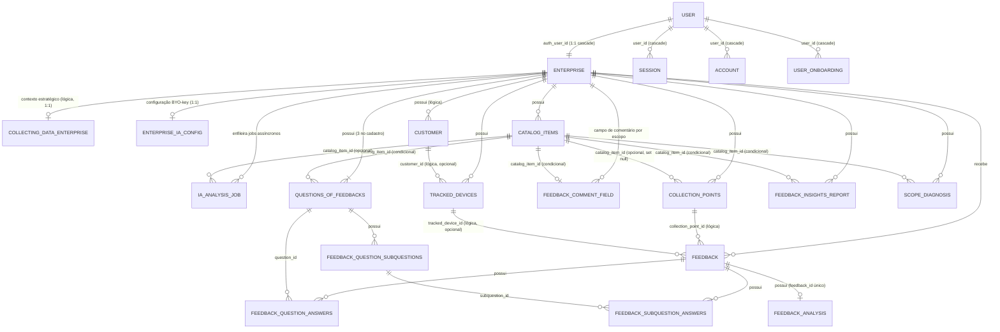

# Diagrama de Entidade e Relacionamento (DER)

> Guia conceitual das entidades do banco de dados, seus campos principais e como se relacionam. Para a referência técnica completa (RLS, índices, triggers, funções), consulte [Visão Geral do Banco de Dados](../referencia/banco-de-dados/visao-geral.md).
>
> **Fonte da verdade:** o schema vive no repositório do gateway, em [`drizzle/schema/`](https://github.com/TCC-Feedback-Analytics/feedback-analytics-api-gateway/tree/main/drizzle/schema), e muda só por migration (`drizzle/0000` a `0014` hoje). Este guia resume esse schema; na dúvida, vale o código.

---

## Mapa de Relacionamentos

> **Legenda de cardinalidade:** `||` = exatamente 1 · `o|` = 0 ou 1 (opcional) · `|{` = 1 ou muitos · `o{` = 0 ou muitos. Os rótulos marcados com **(lógica)** são relações que a aplicação mantém, mas que não têm FK nas migrations.

**Visualizar o código no site: https://mermaid.ai/** 

> **Fora do diagrama, por não terem FK:** `verification` (tokens do Better Auth), `auth_rate_limit` (limite de reenvio de e-mail, por chave) e `ia_rate_budget` (orçamento de chamadas à IA, cujo `scope` guarda o id da empresa em texto).

> **Isolamento:** os dados de negócio carregam `enterprise_id`, e é por ele que a aplicação filtra cada query (o isolamento entre empresas fica no gateway). As exceções são as tabelas filhas (`feedback_question_subquestions`, `feedback_question_answers`, `feedback_subquestion_answers` e `feedback_analysis`), que chegam à empresa pela tabela pai, e as tabelas por usuário ou por chave (`user`, `session`, `account`, `verification`, `user_onboarding`, `auth_rate_limit`, `ia_rate_budget`). Ao excluir a conta, o gateway apaga também o que não tem FK em cascata (`customer`, `collecting_data_enterprise`, `ia_rate_budget`) antes de apagar a empresa.

> **View `enterprise_public` (não é entidade física, por isso fora do `erDiagram`):** expõe apenas `id` e `name`, onde `name` deriva de `public.user.name` (a tabela `enterprise` não tem coluna `name`). O gateway a lê no formulário público, para mostrar o nome da empresa, e ao montar o contexto da empresa enviado à IA.

---

## Grupos de Entidades

### 1. Identidade e Empresa

#### `public.user` (Better Auth)
Gerenciado pelo Better Auth no schema `public`. Registra a conta do empresário/gestor.

| Campo | Tipo | Descrição |
|---|---|---|
| `id` | uuid | Chave primária |
| `name` | text | Nome do gestor / empresa (exibido no painel e na view pública) |
| `email` | text | E-mail de login (único) |
| `email_verified` | boolean | Status de confirmação do e-mail |
| `phone` | text | Telefone de contato (único) |
| `image` | text | Imagem/Avatar do perfil (opcional) |

> A empresa nasce nos ganchos do Better Auth (`src/auth/enterpriseOnSignup.ts`): no cadastro com senha ou na primeira entrada com o Google, o gateway cria a `enterprise` vinculada com trial de 4 meses (`subscription_status = 'TRIAL'`) e semeia as 3 perguntas padrão (`COMPANY`).
> 
> As sessões e credenciais são distribuídas nas tabelas auxiliares do Better Auth: `public.session` (sessões ativas), `public.account` (provedores, como senha e Google, e o hash da senha) e `public.verification` (tokens temporários).

---

#### `enterprise`
Empresa vinculada ao usuário autenticado. Âncora de todo o isolamento multi-tenant.

| Campo | Tipo | Descrição |
|---|---|---|
| `id` | uuid | Chave primária |
| `auth_user_id` | uuid | FK → `public.user.id` (1:1, único, `ON DELETE CASCADE`) |
| `terms_version` | text | Versão dos termos aceitos |
| `terms_accepted_at` | timestamptz | Data de aceite dos termos |
| `trial_ends_at` | timestamptz | Data de expiração do período de teste (NOW() + 4 meses no signup) |
| `subscription_status` | text | `TRIAL` \| `ACTIVE` \| `EXPIRED` \| `CANCELED` (default `TRIAL`) |

> Sem CPF/CNPJ: as colunas `document` e `account_type` saíram na migration `0009`, porque o sistema não usa esse dado e não deve guardá-lo (LGPD).

---

#### `collecting_data_enterprise`
Contexto estratégico da empresa usado como entrada para a análise da IA. No máximo um registro por empresa (`enterprise_id` único); ele só existe depois que a empresa preenche o contexto.

| Campo | Tipo | Descrição |
|---|---|---|
| `id` | uuid | Chave primária |
| `enterprise_id` | uuid | Empresa dona (único; sem FK nas migrations) |
| `company_objective` | text | Objetivo central da empresa |
| `analytics_goal` | text | O que a empresa quer descobrir com os feedbacks |
| `business_summary` | text | Resumo do negócio |
| `main_products_or_services` | text[] | Lista dos principais produtos/serviços |
| `uses_company_products` | bool | Habilita escopo Produtos |
| `uses_company_services` | bool | Habilita escopo Serviços |
| `uses_company_departments` | bool | Habilita escopo Departamentos |

---

#### `user_onboarding`
Guia do sistema (tour da Web): registra, por usuário, os tours concluídos ou pulados.

| Campo | Tipo | Descrição |
|---|---|---|
| `user_id` | uuid | FK → `public.user.id` (`ON DELETE CASCADE`) |
| `tour_key` | text | Qual tour (hoje, `system-guide`) |
| `version` | int | Versão do tour (maior que 0); uma versão nova volta a aparecer |
| `status` | text | `completed` ou `skipped` |
| `finished_at` | timestamptz | Quando o usuário terminou ou pulou |

> Chave primária composta: `(user_id, tour_key, version)`.

---

#### `auth_rate_limit`
Contador durável do limite de reenvio do e-mail de confirmação, compartilhado entre as instâncias serverless.

| Campo | Tipo | Descrição |
|---|---|---|
| `key` | text | Chave primária: tipo do limite (`ip`, `email` ou `cooldown`) mais o HMAC do IP ou do e-mail — nunca o valor em claro |
| `used` | int | Tentativas usadas na janela |
| `expires_at` | timestamptz | Fim da janela |

---

### 2. Catálogo e Pontos de Coleta

#### `catalog_items`
Produtos, serviços ou departamentos que a empresa quer avaliar individualmente. Cada item pode ter seu próprio ponto de coleta (QR Code, link e NFC), perguntas, campo de comentário, relatório de insights e diagnóstico.

| Campo | Tipo | Descrição |
|---|---|---|
| `id` | uuid | Chave primária |
| `enterprise_id` | uuid | FK → `enterprise.id` |
| `kind` | text | `PRODUCT`, `SERVICE` ou `DEPARTMENT` |
| `name` | text | Nome do item |
| `description` | text | Descrição opcional |
| `status` | text | `ACTIVE` ou `INACTIVE` |
| `sort_order` | int | Ordem de exibição |

---

#### `collection_points`
Pontos de coleta de feedback — no banco, sempre do tipo `QR_CODE`. O mesmo ponto atende o QR Code, o link compartilhado e a etiqueta NFC; o canal de cada resposta fica em `feedback.channel`. Podem estar vinculados à empresa em geral (escopo COMPANY) ou a um item específico do catálogo.

| Campo | Tipo | Descrição |
|---|---|---|
| `id` | uuid | Chave primária |
| `enterprise_id` | uuid | FK → `enterprise.id` |
| `catalog_item_id` | uuid | FK → `catalog_items.id` (opcional — nulo = escopo COMPANY; `ON DELETE SET NULL`) |
| `name` | text | Nome do ponto de coleta |
| `type` | text | `QR_CODE` (único tipo gravado pelo gateway) |
| `identifier` | text | Identificador opcional |
| `status` | text | `ACTIVE` ou `INACTIVE` |

---

### 3. Rastreamento e Identificação

#### `tracked_devices`
Rastreia cada dispositivo que acessa o formulário público via fingerprint (MD5 de user-agent + IP). Controla limites de envio e bloqueio de spam.

| Campo | Tipo | Descrição |
|---|---|---|
| `id` | uuid | Chave primária |
| `enterprise_id` | uuid | FK → `enterprise.id` |
| `customer_id` | uuid | Cliente associado (opcional — só preenchido se o cliente se identificar; sem FK) |
| `device_fingerprint` | text | Hash MD5 (user-agent + IP) |
| `user_agent` | text | User-agent do navegador |
| `ip_address` | inet | IP de origem |
| `feedback_count` | int | Total de feedbacks enviados por este dispositivo |
| `last_feedback_at` | timestamptz | Data do último envio |
| `is_blocked` | bool | `true` = dispositivo bloqueado |
| `blocked_reason` | text | Motivo do bloqueio |
| `blocked_at` / `blocked_by` | timestamptz / uuid | Quando e por quem foi bloqueado (sem FK) |

> O dia fica fora do hash: o dispositivo que volta noutro dia, no mesmo navegador e na mesma rede, reaproveita o mesmo `tracked_device`. O limite diário é conferido pela data dos feedbacks (meia-noite de Brasília).

---

#### `customer`
Dados básicos do cliente final, preenchidos **somente se ele optar por se identificar** no formulário. O anonimato é o padrão.

| Campo | Tipo | Descrição |
|---|---|---|
| `id` | uuid | Chave primária |
| `enterprise_id` | uuid | Empresa dona (sem FK nas migrations) |
| `name` | text | Nome (opcional) |
| `email` | text | E-mail (opcional; o gateway deduplica por ele) |
| `gender` | text | Gênero (opcional) |

---

### 4. Estrutura da Pesquisa

#### `questions_of_feedbacks`
Perguntas dinâmicas exibidas no formulário. Podem ter escopo da empresa inteira (`COMPANY`) ou de um item específico do catálogo (`PRODUCT`, `SERVICE` ou `DEPARTMENT`). **3 perguntas COMPANY são criadas automaticamente no signup** e servem como base enquanto a empresa não personaliza; com o contexto e a IA configurados, a IA pode gerar perguntas no lugar delas, se ainda forem as padrão.

| Campo | Tipo | Descrição |
|---|---|---|
| `id` | uuid | Chave primária |
| `enterprise_id` | uuid | FK → `enterprise.id` |
| `scope_type` | text | `COMPANY`, `PRODUCT`, `SERVICE` ou `DEPARTMENT` |
| `catalog_item_id` | uuid | FK → `catalog_items.id` (nulo quando `scope_type = COMPANY`) |
| `question_order` | int | Posição da pergunta (1, 2 ou 3) |
| `question_text` | text | Texto da pergunta (20–150 chars) |
| `is_active` | bool | Controla se a pergunta aparece no formulário |

---

#### `feedback_question_subquestions`
Sub-perguntas vinculadas a uma pergunta principal para maior detalhamento. Cada pergunta suporta até 3 sub-perguntas.

| Campo | Tipo | Descrição |
|---|---|---|
| `id` | uuid | Chave primária |
| `question_id` | uuid | FK → `questions_of_feedbacks.id` |
| `subquestion_order` | int | Posição (1, 2 ou 3) |
| `subquestion_text` | text | Texto da sub-pergunta (20–150 chars) |
| `is_active` | bool | Controla visibilidade no formulário |

---

#### `feedback_comment_field`
Como o campo de comentário aparece no formulário de cada escopo: o convite padrão, uma pergunta própria ou o campo oculto. Sem linha para o escopo = convite padrão.

| Campo | Tipo | Descrição |
|---|---|---|
| `id` | uuid | Chave primária |
| `enterprise_id` | uuid | FK → `enterprise.id` |
| `scope_type` | text | `COMPANY`, `PRODUCT`, `SERVICE` ou `DEPARTMENT` |
| `catalog_item_id` | uuid | FK → `catalog_items.id` (nulo no escopo `COMPANY`) |
| `mode` | text | `DEFAULT`, `CUSTOM` ou `HIDDEN` (default `DEFAULT`) |
| `prompt` | text | A pergunta própria (obrigatória e com 10–150 chars só no modo `CUSTOM`) |

> No máximo uma linha por empresa no escopo `COMPANY` e uma por item do catálogo.

---

### 5. Captação de Dados (O Feedback)

#### `feedback`
Registro central da avaliação enviada pelo cliente. Agrega todos os dados de uma submissão: quem enviou, de onde, por qual canal, a mensagem e a nota geral.

| Campo | Tipo | Descrição |
|---|---|---|
| `id` | uuid | Chave primária |
| `enterprise_id` | uuid | FK → `enterprise.id` |
| `collection_point_id` | uuid | Ponto de coleta de origem (obrigatório; sem FK nas migrations) |
| `tracked_device_id` | uuid | Dispositivo emissor (opcional; sem FK nas migrations) |
| `message` | text | Comentário livre do cliente (texto vazio quando ele só deu as notas ou o campo está oculto) |
| `comment_prompt` | text | A pergunta própria que o cliente viu no campo de comentário (nulo = convite padrão) |
| `channel` | text | Canal de coleta: `QR`, `LINK`, `NFC` ou `TEST` (o "Testar o formulário", fora das métricas e da IA); nulo = sem a marca de canal |
| `rating` | int | Nota geral (1–5 estrelas) |

---

#### `feedback_question_answers`
Resposta do cliente para cada pergunta dinâmica. Armazena um **snapshot do texto da pergunta** no momento da submissão, garantindo que alterações futuras na pergunta não corrompam o histórico.

| Campo | Tipo | Descrição |
|---|---|---|
| `id` | uuid | Chave primária |
| `feedback_id` | uuid | FK → `feedback.id` |
| `question_id` | uuid | FK → `questions_of_feedbacks.id` |
| `question_text_snapshot` | text | Texto da pergunta no momento da resposta |
| `answer_value` | text | `PESSIMO`, `RUIM`, `MEDIANA`, `BOA` ou `OTIMA` |
| `answer_score` | int | Score numérico (1–5) correspondente ao `answer_value` |

---

#### `feedback_subquestion_answers`
Resposta do cliente para cada sub-pergunta. Mesmo mecanismo de snapshot de `feedback_question_answers`.

| Campo | Tipo | Descrição |
|---|---|---|
| `id` | uuid | Chave primária |
| `feedback_id` | uuid | FK → `feedback.id` |
| `subquestion_id` | uuid | FK → `feedback_question_subquestions.id` |
| `subquestion_text_snapshot` | text | Texto da sub-pergunta no momento da resposta |
| `answer_value` | text | `PESSIMO`, `RUIM`, `MEDIANA`, `BOA` ou `OTIMA` |
| `answer_score` | int | Score numérico (1–5) |

---

### 6. Processamento por Inteligência Artificial

#### `feedback_analysis`
Análise individual gerada pela IA para um feedback específico. Relação 1:1 com `feedback`.

| Campo | Tipo | Descrição |
|---|---|---|
| `id` | uuid | Chave primária |
| `feedback_id` | uuid | FK → `feedback.id` (único) |
| `sentiment` | text | Sentimento extraído pela IA |
| `categories` | text[] | Categorias temáticas identificadas |
| `keywords` | text[] | Palavras-chave relevantes extraídas |
| `aspects` | jsonb | Sentimento por aspecto (ABSA) extraído do texto |
| `sentiment_score` | numeric | Intensidade graduada do sentimento geral em `[-1, 1]` |
| `confidence` | numeric | Confiança da classificação em `[0, 1]` |

---

#### `feedback_insights_report`
Relatório consolidado gerado pela IA sobre um conjunto de feedbacks. Pode cobrir a empresa inteira (`COMPANY`) ou um item específico do catálogo. É regenerável - um novo relatório sobrescreve o anterior para o mesmo escopo.

| Campo | Tipo | Descrição |
|---|---|---|
| `id` | uuid | Chave primária |
| `enterprise_id` | uuid | FK → `enterprise.id` |
| `scope_type` | text | `COMPANY`, `PRODUCT`, `SERVICE` ou `DEPARTMENT` |
| `catalog_item_id` | uuid | FK → `catalog_items.id` (nulo quando `scope_type = COMPANY`) |
| `catalog_item_name` | text | Snapshot do nome do item no momento da geração |
| `summary` | text | Resumo executivo gerado pela IA |
| `recommendations` | text[] | Lista de recomendações práticas |

---

#### `scope_diagnosis`
Diagnóstico do escopo gerado pela IA a partir dos números já calculados do período (e do período anterior). Guarda o histórico — um diagnóstico novo não apaga o anterior.

| Campo | Tipo | Descrição |
|---|---|---|
| `id` | uuid | Chave primária |
| `enterprise_id` | uuid | FK → `enterprise.id` |
| `scope_type` | text | `COMPANY`, `PRODUCT`, `SERVICE` ou `DEPARTMENT` (default `COMPANY`) |
| `catalog_item_id` | uuid | FK → `catalog_items.id` (nulo no escopo `COMPANY`) |
| `period_start` / `period_end` | timestamptz | Período analisado |
| `previous_start` / `previous_end` | timestamptz | Período de comparação |
| `feedback_count` | int | Avaliações no período quando o diagnóstico foi gerado |
| `data_hash` | text | sha256 do pacote enviado à IA: o mesmo recorte com os mesmos dados não paga IA de novo |
| `model` | text | Modelo de IA usado |
| `result` | jsonb | O diagnóstico devolvido pela IA |

---

### 7. Fila Assíncrona e Provedores de IA

#### `enterprise_ia_config`
Configurações do provedor de inteligência artificial por empresa (BYO-key). Relação 1:1 com `enterprise`. Armazena a chave de API cifrada com AES-256-GCM.

| Campo | Tipo | Descrição |
|---|---|---|
| `id` | uuid | Chave primária |
| `enterprise_id` | uuid | FK → `enterprise.id` (UNIQUE, `ON DELETE CASCADE`) |
| `provider` | text | Provedor de IA (`openrouter` ou `gemini`; default `openrouter`, o único que o gateway grava) |
| `model` | text | Identificador do modelo de linguagem configurado |
| `api_key_ciphertext` | text | Texto cifrado da chave da API do provedor externo |
| `api_key_iv` | text | Vetor de inicialização (IV) usado na cifra AES-256-GCM |
| `api_key_auth_tag` | text | Tag de integridade/autenticação da criptografia |
| `key_hint` | text | Sufixo da chave (últimos 4 caracteres) visível na UI |
| `created_at` / `updated_at` | timestamptz | Carimbos de auditoria |

---

#### `ia_analysis_job`
Fila durável e máquina de estados das operações assíncronas de IA. O worker realiza a captura concorrente via `SELECT ... FOR UPDATE SKIP LOCKED`.

| Campo | Tipo | Descrição |
|---|---|---|
| `id` | uuid | Chave primária do job |
| `enterprise_id` | uuid | FK → `enterprise.id` (escopo multi-tenant obrigatório) |
| `job_type` | text | Tipo da tarefa: `analyze_raw`, `regenerate_insights`, `generate_company_questions` ou `generate_scope_diagnosis` |
| `scope_type` | text | `COMPANY`, `PRODUCT`, `SERVICE` ou `DEPARTMENT` |
| `catalog_item_id` | uuid | FK → `catalog_items.id` (opcional) |
| `status` | text | Estado: `queued`, `running`, `waiting_budget`, `completed` ou `failed` |
| `total` | integer | Total de itens a processar no job |
| `done` | integer | Itens já processados |
| `options` | jsonb | Parâmetros do pedido e o checkpoint do worker (`options.checkpoint`) |
| `attempts` | integer | Contador de posses do job (sobe a cada vez que um worker o pega) |
| `next_run_at` | timestamptz | Quando o job fica elegível; enquanto `running`, marca o fim do lease |
| `error_code` | text | Código padronizado em caso de falha da operação |
| `requested_by` | uuid | Usuário que disparou o job (sem FK) |
| `created_at` / `updated_at` | timestamptz | Carimbos de criação e atualização |

> Um índice parcial único impede dois jobs ativos (`queued`, `running` ou `waiting_budget`) para a mesma empresa, tipo, escopo e item.

---

#### `ia_rate_budget`
Token bucket persistente para controle de ritmo das chamadas à IA (back-pressure), por janela de minuto e de dia.

| Campo | Tipo | Descrição |
|---|---|---|
| `id` | uuid | Chave primária |
| `scope` | text | De quem é o orçamento: o id da empresa (em texto) no worker; `global` é o default |
| `window_kind` | text | Janela temporal: `minute` ou `day` |
| `window_start` | timestamptz | Início da janela |
| `used` | integer | Reservas usadas na janela |
| `created_at` | timestamptz | Criação do registro |

> Único por `(scope, window_kind, window_start)`, o que permite a reserva atômica por upsert.

---

## Enumerações e Constantes

| Enum / Check | Valores |
|---|---|
| `catalog_items.kind` | `PRODUCT`, `SERVICE`, `DEPARTMENT` |
| `catalog_items.status` | `ACTIVE`, `INACTIVE` |
| `collection_points.type` | `QR_CODE` (sem CHECK no banco; é o valor que o gateway grava) |
| `collection_points.status` | `ACTIVE`, `INACTIVE` (sem CHECK no banco) |
| `questions_of_feedbacks.scope_type` | `COMPANY`, `PRODUCT`, `SERVICE`, `DEPARTMENT` |
| `feedback_insights_report.scope_type` | `COMPANY`, `PRODUCT`, `SERVICE`, `DEPARTMENT` |
| `feedback_comment_field.scope_type` | `COMPANY`, `PRODUCT`, `SERVICE`, `DEPARTMENT` |
| `feedback_comment_field.mode` | `DEFAULT`, `CUSTOM`, `HIDDEN` |
| `scope_diagnosis.scope_type` | `COMPANY`, `PRODUCT`, `SERVICE`, `DEPARTMENT` |
| `feedback.channel` | `QR`, `LINK`, `NFC`, `TEST` (ou nulo) |
| `enterprise.subscription_status` | `TRIAL`, `ACTIVE`, `EXPIRED`, `CANCELED` |
| `answer_value` (respostas) | `PESSIMO`, `RUIM`, `MEDIANA`, `BOA`, `OTIMA` |
| `user_onboarding.status` | `completed`, `skipped` |
| `enterprise_ia_config.provider` | `gemini`, `openrouter` |
| `ia_analysis_job.job_type` | `analyze_raw`, `regenerate_insights`, `generate_company_questions`, `generate_scope_diagnosis` |
| `ia_analysis_job.status` | `queued`, `running`, `waiting_budget`, `completed`, `failed` |
| `ia_rate_budget.window_kind` | `minute`, `day` |

---

## Veja Também

- [Visão Geral do Banco de Dados](../referencia/banco-de-dados/visao-geral.md) — referência técnica completa (RLS, triggers, funções, índices)
- [Modelo Conceitual (MER)](modelo-conceitual-mer.md) — relacionamentos e cardinalidades em alto nível
