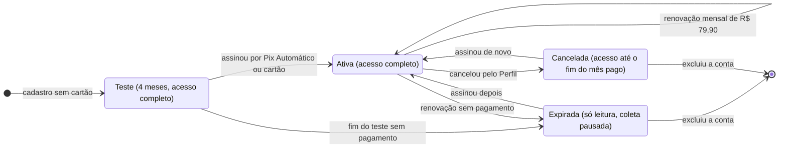

# Modelo de Negócio — Feedback Analytics

Este documento descreve como o Feedback Analytics funciona como negócio: para quem é feito, como gera receita, como chega até o cliente e como medir se está crescendo de forma saudável.

Entender o modelo de negócio é tão importante quanto entender o código. Ele responde a pergunta mais fundamental do projeto: **por que este produto existe e como ele se sustenta.**

!!! note "Material de concepção (jun–jul/2026)"
    Este documento registra o modelo de negócio pensado na concepção e não foi reescrito. Em 19/11/2026 entraram o preço de R$ 79,90 e a seção Cobrança e pagamento. Em 03/11/2026 e de novo em 16/11/2026, só as afirmações técnicas foram conferidas contra o código. O que o sistema faz hoje está em [Requisitos e Funcionalidades](./requisitos-e-funcionalidades.md).

---

## Proposta de Valor

> O que o produto entrega que justifica o cliente pagar por ele?

O Feedback Analytics transforma a opinião dos clientes finais em decisões estratégicas — de forma automatizada, sem exigir que a empresa tenha equipe técnica ou de dados.

O produto resolve isso em três etapas:

| Etapa | O que acontece |
|---|---|
| **1. Colete** | A empresa ativa a coleta por produto, serviço ou departamento, com QR Code, link ou etiqueta NFC exclusivos de cada um. O cliente abre o formulário, avalia e vai embora — sem criar conta. |
| **2. Analise** | Um pipeline de IA interpreta cada feedback automaticamente: classifica sentimento, extrai temas e palavras-chave. |
| **3. Decida** | O dashboard apresenta um painel de insights por escopo, com recomendações prontas. O gestor para de decidir por intuição e começa a decidir por evidência. |

**Por que isso importa para o projeto:** a proposta de valor define o que deve estar sempre funcionando. Se a coleta travar, se a IA falhar ou se o dashboard demorar, o produto perde seu argumento central. Tudo que está na arquitetura técnica — anti-spam, resiliência da IA, performance do dashboard — existe para proteger essas três etapas. Hoje a resiliência da IA não inclui um fallback quando o provedor falha: a análise falha com um código tipado e não grava resultado parcial.

---

## Segmento de Clientes

> Para quem o produto é feito?

O cliente do Feedback Analytics é a **empresa** (o gestor), não o consumidor final que preenche o formulário. O consumidor final é o canal de coleta — o cliente real é quem paga pela assinatura e usa o dashboard.

| Perfil | Dor que o produto resolve |
|---|---|
| **Restaurantes e lojas físicas** | Coleta presencial de baixo atrito — o cliente avalia na hora, sem baixar app ou criar conta |
| **Profissionais autônomos e pequeno comércio** | Satisfação por produto/serviço, sem montar planilhas |
| **Times sem equipe técnica** | Solução pronta, que funciona sem nenhum desenvolvimento interno |

**Foco principal:** pequenas e médias empresas (PMEs) que não têm orçamento para ferramentas de pesquisa complexas ou consultorias de dados, mas precisam de informação estruturada para tomar decisões melhores.

**Por que isso importa para o projeto:** conhecer o segmento guia decisões de UX. O formulário público precisa ser extremamente simples porque o cliente final não foi treinado para usá-lo. O dashboard precisa ser claro porque o gestor não é analista de dados.

---

## Modelo de Receita

> Como o produto ganha dinheiro?

O Feedback Analytics opera no modelo **SaaS (Software as a Service)** com assinatura mensal recorrente. Não existe plano gratuito permanente — o produto cobra pelo valor que entrega.

### Trial de 4 Meses

Todo novo cadastro recebe **4 meses de uso gratuito** com acesso completo ao Plano Básico.

Esse período existe por uma razão estratégica: feedback analytics é um produto que precisa de volume de dados para mostrar seu valor. Em 4 meses, a empresa já terá coletado feedbacks suficientes para ver insights reais e entender o que está funcionando e o que não está. O trial não é um desconto — é o tempo necessário para o produto provar o seu valor.

> **Implementação técnica:** ao criar a conta, o gateway grava `trial_ends_at = NOW() + 4 months` e `subscription_status = 'TRIAL'` na tabela `enterprise` (`src/auth/enterpriseOnSignup.ts`, no lugar do antigo trigger `on_auth_user_created`). O badge de status, no menu da conta e no Perfil, mostra o ciclo de vida: `TRIAL` (âmbar, com os dias restantes) → `ACTIVE` (verde) / `EXPIRED` (vermelho) / `CANCELED` (cinza). Ainda não há cobrança: nada no código muda o status depois do cadastro nem bloqueia o acesso ao fim do trial.

### Plano Básico

| Item | Detalhe |
|---|---|
| **Preço** | R$ 79,90 / mês |
| **Análise por IA** | Vem no plano, sem upgrade. O consumo do modelo é pago pela empresa direto ao provedor, na conta OpenRouter que ela conecta, e por isso fica fora dos R$ 79,90 |
| **O que inclui** | Canais de coleta (QR Code, link e NFC) com todos os tipos de feedback: Empresa (Geral), Produtos, Serviços e Departamentos |
| **Restrição** | Nenhuma além do plano — acesso completo ao produto |

**Por que isso importa para o projeto:** No começo para mostrar o valor do produto um único plano simplifica o produto e a experiência. Não há lógica de feature flag ou bloqueio por tier para manter no código. Todo usuário autenticado tem acesso a tudo — o esforço de desenvolvimento vai para o produto em si, não para gerenciar limites de plano.

### Cobrança e pagamento

!!! info "Definido em 19/11/2026, para implementar depois da apresentação à banca"
    A cobrança ainda não existe no código: hoje toda conta fica no período de teste, sem bloqueio no fim. A tabela abaixo é como ela vai funcionar.

| Momento | Como funciona |
|---|---|
| **Cadastro** | Sem cartão e sem pagamento. A conta nasce no período de teste de 4 meses (`TRIAL`), como já acontece hoje. Pedir cartão logo no cadastro afastaria justamente o pequeno negócio que ainda não viu o valor do produto. |
| **Fim do teste** | Avisos 7 dias e 1 dia antes do fim. A empresa assina pelo Perfil, por **Pix Automático** (o Pix recorrente do Banco Central) ou **cartão de crédito**, por um intermediador de pagamento brasileiro, como Mercado Pago ou Asaas. Com o pagamento confirmado, o status vira `ACTIVE`. |
| **Renovação** | Cobrança mensal recorrente de R$ 79,90, no mesmo meio de pagamento. |
| **Sem pagamento** | O status vira `EXPIRED`. O painel fica só para leitura e a coleta é pausada em todos os canais, com a mesma pausa que o gestor já usa hoje. Os dados continuam guardados até o gestor excluir a conta e voltam a valer se a empresa assinar. O prazo de guarda das contas expiradas entra no [inventário de dados pessoais](../seguranca/inventario-de-dados.md) junto com a cobrança. |
| **Cancelamento** | Pelo Perfil, a qualquer momento e sem multa. O acesso continua até o fim do mês já pago, e o status vira `CANCELED`. A exclusão da conta, que já existe, apaga a empresa e todos os dados. |
| **Uso da IA** | A análise por IA vem no plano, sem upgrade. O consumo do modelo é pago pela empresa direto ao provedor, na conta OpenRouter que ela conecta, porque cada empresa escolhe o próprio modelo e paga só o que usa. |

O diagrama mostra o mesmo fluxo pelos status que a empresa já tem no banco (`subscription_status`).


**Por que isso importa para o projeto:** a cobrança mexe no status da empresa, que já existe no banco (`subscription_status` e `trial_ends_at`) e já aparece no badge do menu e do Perfil. O que falta é o intermediador avisar o pagamento ao gateway e o gateway aplicar o modo leitura e a pausa da coleta quando o status for `EXPIRED`.

---

## Diferenciais Competitivos

> Por que um cliente escolheria o Feedback Analytics em vez de uma alternativa?

Existem dois diferenciais que fazem o cliente dizer **"é esse que eu preciso"** — não porque o produto tem mais funcionalidades, mas porque ele resolve um problema que a alternativa genérica não resolve.

### "Eu sei exatamente onde está o problema"

A maioria das ferramentas de feedback entrega um formulário genérico para a empresa inteira. O Feedback Analytics gera uma **coleta independente por produto, serviço ou departamento**, com QR Code, link e etiqueta NFC próprios.

O que muda na prática: um gestor de restaurante para de saber que "os clientes estão insatisfeitos" e começa a saber que "o atendimento tem nota 2.6 enquanto a cozinha tem 4.2". Ele sabe onde agir — e age. Essa granularidade é o principal argumento de venda do produto.

---

### "Eu não preciso ler 200 feedbacks para entender o que está acontecendo"

Gestores de PMEs não têm equipe de dados e não têm tempo. Ler feedbacks um a um não é viável. O produto lê tudo automaticamente e devolve **recomendações prontas**: temas recorrentes, carga emocional, o que está funcionando e o que precisa mudar.

O que muda na prática: o gestor abre o painel de insights e já tem a decisão encaminhada. Não é um relatório de dados — é uma ação sugerida.

---

**Por que isso importa para o projeto:** esses dois diferenciais são as partes do sistema que nunca podem degradar. Se a coleta por escopo parar de funcionar ou o painel de insights ficar vazio, o produto perde os dois únicos argumentos que fazem o cliente escolher ele.

---

## Canais de Aquisição

> Como os clientes chegam até o produto?

### Product-Led Growth pelo formulário de coleta

O próprio produto é o principal canal de aquisição. Quando um cliente final abre o formulário de uma empresa (pelo QR Code, pelo link ou pela etiqueta NFC) e o preenche, ele está vendo o produto em funcionamento. Uma simples atribuição no rodapé do formulário ("Powered by Feedback Analytics") transforma cada ponto de coleta em uma vitrine.

**Hoje:** o formulário ainda não mostra essa atribuição no rodapé. O cabeçalho do formulário mostra a marca "Feedback Analytics", sem link para o site.

**Por que é poderoso:** não tem custo por impressão e escala com o crescimento de cada cliente. Quanto mais QR Codes, links e etiquetas uma empresa distribui, mais pessoas descobrem o produto.

### Conteúdo + SEO

Artigos otimizados para termos que o cliente-alvo busca antes de comprar: "como coletar feedback de clientes", "avaliação de produtos para restaurantes", "pesquisa de satisfação para pequenas empresas".

**Por que funciona:** o cliente já está com o problema formulado na cabeça quando encontra o produto — a conversão é mais alta do que anúncios de interrupção.

### LinkedIn

Publicações e anúncios direcionados a donos de pequenos negócios e profissionais autônomos — o perfil exato de quem toma a decisão de compra.

### Comunidades de Empreendedores

Grupos de WhatsApp, Telegram e comunidades online de empreendedores brasileiros são um canal de acesso direto ao segmento de PMEs com alta confiança entre membros.

### Indicação (Referral)

Clientes satisfeitos recomendam para outros negócios da sua rede. Para um produto com ticket de R$ 79,90/mês, um programa de indicação com desconto ou mês grátis tem ROI alto.

---

## Métricas-Chave

> Como saber se o negócio está crescendo de forma saudável?

Métricas são o GPS do produto. Sem elas, as decisões de onde investir tempo e dinheiro são tão intuitivas quanto as do gestor que ainda não usa o Feedback Analytics.

### Taxa de Conversão Trial → Pago

**O que é:** percentual de empresas que, ao fim dos 4 meses de trial, assinam o plano.

**Por que é a métrica mais importante:** o trial é o coração do modelo de receita. Se a conversão for baixa, o produto não está conseguindo provar seu valor no tempo disponível. Isso pode significar problema de onboarding, de produto ou de segmento.

**Meta de referência:** para SaaS com trial longo voltado para negócios, conversões acima de 15–20% são saudáveis.

---

### MRR — Receita Mensal Recorrente

**O que é:** soma de todas as assinaturas ativas no mês. `MRR = clientes pagantes × R$ 79,90`.

**Por que importa:** é o número que mostra a saúde financeira real do negócio. Crescimento consistente de MRR indica produto e aquisição funcionando juntos.

---

### Churn Rate

**O que é:** percentual de clientes pagantes que cancelam por mês.

**Por que importa:** churn alto destrói o MRR mesmo com boa aquisição. Para um produto de R$ 79,90/mês, perder 1 cliente exige ganhar 1 novo só para ficar no mesmo lugar.

**Meta de referência:** churn abaixo de 3% ao mês é considerado saudável para micro-SaaS voltado para negócios.

---

### LTV / CAC

**O que é:**
- **LTV (Lifetime Value):** quanto um cliente gera de receita ao longo de toda a relação. `LTV = R$ 79,90 / churn_rate`
- **CAC (Customer Acquisition Cost):** quanto custa adquirir um cliente (anúncios, tempo, etc.)

**Por que importa:** a relação LTV/CAC mostra se o negócio é sustentável. Se custa R$400 adquirir um cliente que paga R$ 79,90/mês e cancela em 3 meses, o negócio perde dinheiro em cada venda.

**Meta de referência:** LTV deve ser pelo menos 3× o CAC para o modelo ser viável.

---

### Taxa de Ativação

**O que é:** percentual de empresas que ativaram a coleta (por QR Code, link ou NFC) pelo menos uma vez após o cadastro.

**Por que importa:** uma empresa que cadastrou mas nunca ativou a coleta nunca vai ver valor no produto — e certamente não vai converter ao final do trial. Ativação baixa é um sinal de problema de onboarding, não de produto.

---

### Feedbacks Coletados por Empresa / Mês

**O que é:** média de feedbacks que cada empresa recebe mensalmente.

**Por que importa:** este é o principal indicador de engajamento. Uma empresa que coleta muitos feedbacks está usando o produto ativamente e tem muito mais razão para continuar pagando. Engajamento baixo é o maior preditor de churn.

---

## Resumo Visual

```
CLIENTE DESCOBRE          →   Trial 4 meses    →   Converte (R$ 79,90/mês)
(PLG, SEO, LinkedIn)           (ativa a coleta,       (renova enquanto
                                coleta feedbacks,       vê valor nos insights)
                                vê insights)
        ↑                                                      ↓
  Indicação de                                          Churn se não
  clientes satisfeitos                                  vir valor
```

`Preditor de Churn é um comportamento rastreável do usuário que te avisa antecipadamente: "Cuidado, as chances desse cliente cancelar no fim do mês são altíssimas".`

- Churn = É a taxa de cancelamento. Quando o cliente cancela a assinatura e para de te pagar.
- Preditor = Um sintoma ou sinal de alerta que acontece antes do evento final se concretizar.

---

## Veja Também

- [Visão Geral do Sistema](../index.md)
- [Requisitos e Funcionalidades](./requisitos-e-funcionalidades.md)
- [Arquitetura](../arquitetura/visao-geral.md)
