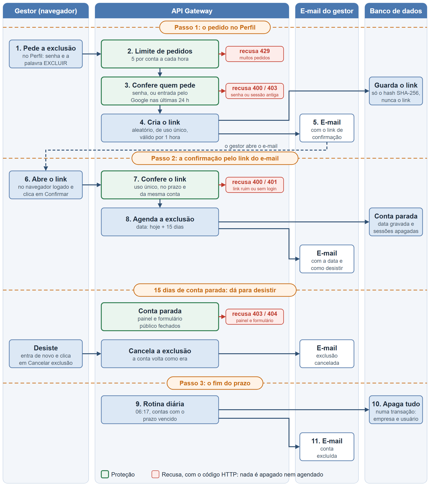

# Minimização de dados pessoais (LGPD)

## O Que É

É o cuidado de **guardar só o dado pessoal que o sistema usa** e de não deixá-lo circular onde não precisa: na sessão do gestor, no navegador, na lista de feedbacks ou na IA.

Vale para as duas pessoas que o sistema conhece:

- o **gestor**, que cria a conta e usa o painel;
- o **cliente final**, que responde ao formulário público (QR Code, link ou etiqueta NFC).

A lista completa de dados pessoais, de onde ficam e com quem são compartilhados está no [inventário de dados](../seguranca/inventario-de-dados.md).

??? note "Histórico: a higienização do JWT na época do Supabase Auth"
    A página nasceu como "Higienização de Dados Sensíveis no JWT". Com o **Supabase Auth**, o provedor guardava os dados do cadastro (CPF/CNPJ e telefone) no payload interno do usuário, que podia ir parar no token JWT. Um JWT é assinado, mas não é cifrado: quem intercepta o token lê o payload, só codificado em Base64. Um trigger no banco apagava esses campos do payload e os movia para a tabela `enterprise`, protegida por RLS.

    A autenticação migrou para o **Better Auth**. A sessão deixou de ser um JWT, o CPF/CNPJ deixou de ser pedido e guardado (migration `0009` do gateway) e o trigger não existe mais: o problema que ele resolvia sumiu com a troca do provedor. A regra correspondente, RNE-011, está marcada como substituída.

---

## Por Que Existe

A **LGPD** pede minimização: tratar só o dado pessoal necessário para a finalidade. Cada dado guardado sem uso é um dado que pode vazar, ir parar num log ou ser visto por quem não precisa.

Na prática, o sistema segue três regras:

- **O que não é usado não é guardado.** O CPF/CNPJ (e o tipo de conta CPF/CNPJ) saiu do cadastro e do banco, porque nada no sistema o usava. Do cliente final, só nome, e-mail e gênero são gravados, e só se ele quiser.
- **A sessão não carrega dados.** O cookie leva só o token da sessão; usuário, e-mail e telefone ficam no banco.
- **Cada um vê só o que precisa.** O gestor não recebe IP, navegador nem fingerprint do cliente; a IA não recebe nome, e-mail nem IP.

---

## O Gestor

### A sessão não usa JWT

A sessão é um **cookie httpOnly** com um token opaco, assinado pelo Better Auth e **conferido no banco a cada requisição**. Não há cache da sessão no cookie (`cookieCache` desligado) nem o plugin `jwt` do Better Auth.

- **O navegador não lê o token.** O cookie é `httpOnly`: o JavaScript da página não tem acesso a ele, e a Web não guarda sessão em `localStorage`.
- **O link de nova senha também é opaco.** O token de redefinição vai num cookie `httpOnly` (`ba_reset`), aceito só na rota de troca de senha.

### Como Funciona

```
Gestor se cadastra (e-mail e senha) ou entra com o Google
        ↓
Better Auth cria o usuário (user), a credencial (account) e,
no login, a sessão (session)
        ↓
Gateway cria a empresa (enterprise) e as 3 perguntas padrão.
No cadastro com senha, o aceite dos termos já vai junto; quem entra
com o Google tem a empresa criada sem os termos, gravados depois
no "Complete seu cadastro"
        ↓
Resposta do login define o cookie httpOnly com o token da sessão
        ↓
A cada requisição protegida, o middleware requireAuth valida a sessão
no banco e resolve a empresa do usuário (req.enterpriseId)
        ↓
Todas as consultas filtram pelo enterprise_id resolvido no servidor
```

### O Que Fica no Cookie vs. O Que Fica no Banco

| Dado | Cookie de sessão | Banco |
|---|---|---|
| Token da sessão | ✅ Só ele, assinado | ✅ `session.token` |
| IP e navegador de onde a sessão foi aberta | ❌ | ✅ `session.ip_address`, `session.user_agent`. Desde o PR #110, o login com e-mail e senha também passa os headers ao Better Auth |
| ID do usuário | ❌ | ✅ `user.id` (`enterprise.auth_user_id` liga a empresa) |
| Nome | ❌ | ✅ `user.name` |
| E-mail | ❌ | ✅ `user.email` |
| Telefone | ❌ | ✅ `user.phone` (único por conta) |
| Senha | ❌ | ✅ `account.password`, só o hash (bcrypt) |
| Tokens do Google (login com Google) | ❌ | ❌ Não são gravados: `account.access_token`, `account.refresh_token` e `account.id_token` ficam vazios |
| Termos de aceite | ❌ | ✅ `enterprise.terms_version`, `enterprise.terms_accepted_at` |
| CPF / CNPJ | ❌ | ❌ Não é mais guardado |

No login com Google, o Better Auth usa os tokens que o Google devolve (`access_token`, `refresh_token` e `id_token`, este um JWT com o e-mail, o nome e a foto da pessoa) para ler o perfil, mas o gateway **não os grava**: os ganchos de criação e de atualização da conta (`discardOAuthTokens`, em `src/auth/auth.ts`) gravam os três vazios. O sistema não chama o Google depois do login. Cifrar com o `encryptOAuthTokens` não bastaria: no Better Auth 1.7.18 ele cifra só o access e o refresh token, e o `id_token` continuaria legível. As contas Google que tinham tokens gravados antes dessa regra perdem os tokens na migration `0015_apagar_tokens_google.sql` (PR #110), que zera os três e mantém as colunas.

A Web lê o telefone e o e-mail do gestor só pelo `GET /api/protected/user/auth_user`, a partir da sessão. O Better Auth também expõe as rotas dele em `/api/auth/*`; pelo comportamento padrão da biblioteca, o `GET /api/auth/get-session` devolve o mesmo usuário (com o telefone) ao próprio gestor logado. Isso não foi executado nesta conferência.

### Isolamento e Acesso ao Banco

- **Isolamento por empresa na aplicação.** O `enterprise_id` vem da sessão, nunca do payload, e todo repositório filtra por ele (`src/db/tenantScope.ts` do gateway).
- **Papel `feedback_app`.** O gateway entra no banco com um papel que só lê e escreve dados: não cria, altera nem apaga tabelas, não desliga a RLS nem cria usuários (migration `0013`).
- **RLS ligada em todas as tabelas,** com uma policy que deixa passar só o `feedback_app`. Ela barra outros papéis, como o `anon` e o `authenticated` do Supabase, mas não separa uma empresa da outra: essa separação é a da aplicação (veja [ORM × RLS](../arquitetura/orm-rls-decisao.md)).

### Exclusão da Conta

O gestor pode apagar a conta e todos os dados da empresa pelo **Perfil**, na seção "Excluir minha conta" (LGPD, art. 18).

- A Web pede a senha a quem tem uma e a palavra EXCLUIR para liberar o botão. Quem só entra pelo Google precisa ter entrado nas últimas 24 horas. São no máximo 5 pedidos por conta por hora.
- O pedido manda ao e-mail da conta o link "Confirme a exclusão da sua conta", que vale 1 hora, só funciona no navegador logado e só pode ser usado uma vez. O banco guarda só o hash do link. Nada é apagado nesse passo.
- O clique em "Confirmar a exclusão", na página do link, marca a data da exclusão para dali a 15 dias e encerra todas as sessões. Nesse prazo, a conta fica parada: o painel fecha e o formulário público não abre nem grava respostas. O gestor pode entrar de novo e cancelar.
- No fim do prazo, uma rotina diária apaga, numa transação, a empresa e tudo dela (feedbacks, análises, catálogo, perguntas, pontos de coleta, aparelhos, clientes, contexto da empresa, configuração de IA, jobs e diagnósticos) e o usuário, com as sessões e as credenciais.
- Depois disso, não há volta.



---

## O Cliente Final

O cliente responde sem conta e sem login. O que o sistema guarda dele:

- **Aviso antes do envio.** Antes do botão "Enviar Feedback", o formulário mostra "Seus dados são protegidos e usados apenas para melhorar sua experiência. Ao enviar, você concorda com a Política de Privacidade", com link para a [Política de Privacidade](../seguranca/politica-de-privacidade.md) (`/privacidade` na Web).
- **Dados pessoais só se ele quiser.** Nome, e-mail e gênero ficam num bloco recolhido, "Informações pessoais" ("Nome, e-mail e gênero · Opcional"), que só abre se o cliente clicar.
- **Só nome, e-mail e gênero são gravados,** na tabela `customer`, e só quando vem nome ou e-mail. Telefone, data de nascimento, cidade, estado e país chegam no schema do envio, mas o gateway os descarta. CPF ou documento é descartado pelo próprio schema.
- **IP e navegador ficam no servidor.** O anti-spam guarda o IP, o navegador (*user agent*) e o fingerprint (MD5 dos dois) em `tracked_devices`, ligados ao cliente por `customer_id` quando ele se identificou (veja [Anti-Spam por Fingerprint](./anti-spam-fingerprint.md)).
- **A lista de feedbacks não mostra dados técnicos do aparelho.** Desde 05/11/2026, o painel recebe de cada aparelho só a quantidade de envios e se ele está bloqueado, além do nome, do e-mail e do gênero do cliente, quando informados. IP, navegador e fingerprint não saem do gateway.
- **A IA não recebe dados pessoais.** Ela lê comentários, notas, respostas, a pergunta própria do escopo e o contexto do negócio, nunca nome, e-mail, gênero ou IP do cliente.
- **O QR Code é gerado no navegador.** A imagem sai da biblioteca `qrcode`, sem enviar o endereço do formulário (com o id da empresa) a um serviço de terceiros, como o antigo api.qrserver.com.

---

## Como É Conferido

O teste `src/tests/dataMinimization.test.ts` do gateway roda no CI (job `unit-tests`) e confere:

1. A tabela `session` não tem CPF, documento nem telefone, e guarda só `token`, `userId` e `expiresAt` como identificadores.
2. Na configuração real do login (`getAuth().options`), o cache da sessão no cookie (`cookieCache`) está desligado e não há o plugin `jwt`.
3. O telefone fica na tabela `user`, fora da `session`.
4. A tabela `enterprise` não tem `document`, `account_type`, `cpf` nem `cnpj` (migration `0009`).
5. O schema do formulário público (`publicFeedbackSchema`) não pede CPF nem documento e descarta esses campos se vierem no envio.
6. O schema do cadastro do gestor (`registerSchema`) não pede CPF nem CNPJ.
7. Entrar com Google não grava os tokens do Google: os ganchos de criação e de atualização da conta devolvem o `access_token`, o `refresh_token` e o `id_token` vazios.
8. A migration `0015` zera os tokens só das contas Google, sem `DELETE` nem `DROP`, e está no journal das migrations.

O teste **não cobre**: o IP e o navegador em `tracked_devices`, os dados do cliente na tabela `customer` e o que as respostas da API devolvem (por exemplo, o `get-session` do Better Auth ou a lista de feedbacks). O `authRateLimit.test.ts` confere que o login com senha passa o IP e o navegador ao Better Auth, com o Better Auth simulado.

---

## Importância e Impacto

| Aspecto | Impacto |
|---|---|
| **Apoio à conformidade LGPD** | Dado pessoal não trafega em token legível; o que não é usado não é coletado |
| **Princípio da minimização** | O cookie carrega só o token; o CPF/CNPJ saiu do sistema; do cliente, só nome, e-mail e gênero, e se ele quiser |
| **Sessão protegida no navegador** | Cookie `httpOnly`: um script na página não consegue ler a sessão |
| **Dados técnicos no servidor** | IP, navegador e fingerprint do cliente não chegam ao painel nem à IA |
| **Isolamento multi-tenant** | A empresa vem da sessão e filtra todas as consultas |
| **Direito de exclusão** | O próprio gestor apaga a conta e os dados da empresa |

---

## Detalhes Técnicos

- A configuração da sessão fica em `src/auth/auth.ts` do gateway: cookie `httpOnly`, `SameSite=Lax` (ou `None` com `Secure` quando Web e API estão em domínios diferentes) e `Secure` em produção
- O middleware `requireAuth` chama `getAuth().api.getSession()` e resolve a empresa com `SELECT id FROM enterprise WHERE auth_user_id = <usuário>`. Não há header `Authorization: Bearer`
- A empresa é criada por `provisionEnterpriseForUser` (`src/auth/enterpriseOnSignup.ts`), chamado pelo cadastro com senha, pelo "Complete seu cadastro" e na primeira entrada com o Google (esta sem os termos). Ela substitui o antigo trigger do Supabase
- A exclusão de conta fica em `src/services/accountDeletion.service.ts` e `src/repositories/accountDeletion.repository.ts` do gateway: o pedido (`POST /api/protected/user/account-deletion`), a confirmação (`/confirm`), a desistência (`/cancel`) e a rotina diária `exclusao-de-contas.yml`, que chama `POST /api/internal/account-deletions/purge`. A data marcada fica em `user.deletion_scheduled_for` (migration `0016`). O `POST /api/auth/delete-user` do Better Auth está desligado
- O envio do formulário público é tratado em `src/controllers/public/qrcode.controller.ts`; a lista de feedbacks do painel, em `src/repositories/feedbackList.repository.ts`
- Para a lista completa de dados pessoais, prazos de guarda e operadores, veja o [inventário de dados](../seguranca/inventario-de-dados.md) e [controlador e operador](../seguranca/controlador-e-operador.md)

---

## Referência Técnica

- [Requisitos Não Funcionais — RNF02](../concepcao/requisitos-e-funcionalidades.md#requisitos-não-funcionais-rnf)
- [Regras de Negócio — RNE-011](../concepcao/requisitos-e-funcionalidades.md#regras-de-negócio-rne)
- [Inventário de dados](../seguranca/inventario-de-dados.md)
- [Política de Privacidade](../seguranca/politica-de-privacidade.md)
- [Coleta: QR Code, link e NFC → coleta-qrcode.md](./coleta-qrcode.md)
- [Endpoints de Autenticação](https://github.com/TCC-Feedback-Analytics/feedback-analytics-api-gateway/blob/main/docs/endpoints.md)
