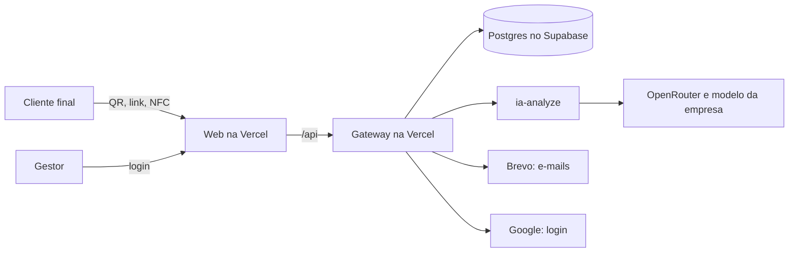

# Mapa de ameaças (STRIDE)

> **Em uma frase:** para cada parte do Feedback Analytics, o que um atacante (ou um erro nosso) poderia fazer, o que já protege no código e o que ainda está aberto.

Parte do [inventário de dados pessoais](inventario-de-dados.md): ele diz **o que** proteger; este documento diz **contra o quê**. Levantado no código do gateway, da Web e do ia-analyze em 02/11/2026.

## Como ler

Cada ameaça leva uma letra do **STRIDE**, um método da Microsoft para não esquecer nenhum tipo de ataque:

| Letra | Ameaça | Pergunta |
|---|---|---|
| **S** | *Spoofing* (falsificação) | Alguém consegue se passar por outra pessoa ou aparelho? |
| **T** | *Tampering* (adulteração) | Alguém consegue alterar um dado que não deveria? |
| **R** | *Repudiation* (repúdio) | Alguém consegue negar que fez algo, sem que possamos provar? |
| **I** | *Information disclosure* (vazamento) | Um dado pode chegar a quem não deveria vê-lo? |
| **D** | *Denial of service* (indisponibilidade) | Alguém consegue derrubar o serviço ou gastar a cota? |
| **E** | *Elevation of privilege* (elevação) | Alguém consegue fazer mais do que deveria poder? |

A situação de cada uma: ✅ protegida · ⚠️ protegida em parte · ❌ aberta.

## Visão geral do sistema

## 1. Formulário público (cliente final)

Qualquer pessoa com o QR, o link ou a etiqueta abre e envia, sem login.

| | Ameaça | O que já protege | Situação |
|---|---|---|---|
| **S** | Uma pessoa envia várias respostas fingindo ser clientes diferentes | Uma resposta por aparelho, ponto de coleta e dia. O aparelho é identificado por um hash de navegador, IP e dia (`qrcode.controller.ts`). O gestor pode bloquear um aparelho | ⚠️ Trocar de rede ou de navegador burla o limite. Aceitável para métrica de satisfação, não para votação |
| **T** | Alterar a marca de canal ou o ponto de coleta na URL | O ponto de coleta precisa estar **ativo** e ser **da empresa** do pedido. A marca de canal serve só a métricas | ✅ |
| **T** | Enviar dado malformado ou gigante | O schema do contrato (`publicFeedbackSchema`) valida tudo: nota de 1 a 5, comentário até 5.000 caracteres, nome até 120 | ✅ |
| **I** | Ver respostas de outros clientes pelo formulário | O formulário só lê o nome da empresa e as perguntas; nenhuma rota pública devolve feedbacks | ✅ |
| **D** | Disparar milhares de envios para encher o banco | O limite por aparelho e dia, mas sem limite por IP nem por tempo no endpoint | ⚠️ |

## 2. Login e sessão (gestor)

| | Ameaça | O que já protege | Situação |
|---|---|---|---|
| **S** | Roubar a conta adivinhando a senha | Better Auth, biblioteca especializada: senha guardada só como hash e força mínima da senha (`passwordStrength.ts`). Login com Google como alternativa | ⚠️ O limite de tentativas é o padrão do Better Auth, contado na memória de cada instância. Na Vercel as instâncias não compartilham essa conta |
| **S** | Descobrir se um e-mail tem conta (enumeração) | Cadastro sem login automático e com confirmação obrigatória de e-mail, respondendo igual nos dois casos (`auth.ts`) | ✅ |
| **S** | Roubar a sessão pelo navegador | Cookie `httpOnly` (o JavaScript da página não lê), `secure` em produção e `sameSite` | ✅ |
| **D** | Usar o "reenviar confirmação" para mandar spam | Limite por IP e por e-mail, com contagem no banco e só o HMAC dos valores (`resendRateLimit.ts`) | ✅ |
| **I** | Vazar os tokens do Google guardados | Ficam na tabela `account`, que só o gateway lê. O sistema não usa esses tokens depois do login | ⚠️ Guardados sem cifra e sem necessidade |

## 3. API do painel (gateway)

| | Ameaça | O que já protege | Situação |
|---|---|---|---|
| **E** | Um gestor ler ou alterar dados de **outra empresa** | A empresa vem da sessão, nunca do pedido (`middlewares/auth.ts`). Toda leitura de feedback passa por um filtro único que exige a empresa e falha se ela faltar (`db/tenantScope.ts`), com testes | ✅ |
| **S** | Outro site chamar a API usando o cookie do gestor | CORS só para as origens da Web (`index.ts`) | ✅ |
| **R** | Um gestor negar que pediu uma análise ou mudou algo | A fila de análises guarda quem pediu (`ia_analysis_job.requested_by`) e o aceite dos termos tem data e versão | ⚠️ Não há registro de quem alterou o quê nas configurações |
| **I** | Um erro devolver detalhes internos | As rotas devolvem códigos de erro tipados (`sendTypedError`), sem pilha de execução | ✅ |

## 4. Banco de dados

| | Ameaça | O que já protege | Situação |
|---|---|---|---|
| **I** | Acessar o banco por fora do app | Data API do Supabase desligada desde 22/10/2026. RLS ligada, sem policies, nas 13 tabelas originais | ⚠️ Oito tabelas novas estão sem RLS |
| **E** | Uma credencial do app vazar e dar acesso total | — | ❌ O gateway entra como `postgres` (superusuário). Com a senha vazada, dá para apagar ou ler tudo, inclusive a estrutura |
| **I** | Ler a chave de IA de uma empresa no banco | Chave cifrada com AES-256-GCM (`utils/crypto.ts`), com a chave mestra fora do banco, nas variáveis da Vercel | ✅ |
| **T** | Perder dados por erro ou ataque | Backups do Supabase | ⚠️ A confirmar no plano contratado; a restauração está no [roteiro de incidente](roteiro-de-incidente.md) |
| **I** | Guardar dado além do necessário | Sem CPF/CNPJ (migration `0009`) | ⚠️ IP do cliente sem prazo de guarda |

## 5. Análise por IA

| | Ameaça | O que já protege | Situação |
|---|---|---|---|
| **I** | Dado pessoal do cliente sair para o provedor de IA | Só vão comentário, nota, respostas e contexto do negócio; nome, e-mail, gênero e IP do cliente nunca vão | ⚠️ O texto do comentário vai como foi escrito e pode conter um telefone ou e-mail |
| **T** | Um cliente escrever no comentário uma instrução para a IA ("ignore as regras e…") | A resposta da IA é validada no formato antes de ser gravada (`ia-analyze/src/validations`) | ⚠️ Não há defesa específica: um comentário pode tentar enviesar o resumo |
| **D** | Esgotar a cota de IA da empresa ou do sistema | Fila assíncrona com orçamento por janela (`ia_rate_budget`) e tentativas limitadas | ✅ |
| **S** | Usar a chave de IA de outra empresa | A chave é escolhida pela empresa da sessão e decifrada só no gateway | ✅ |

## 6. E-mail

| | Ameaça | O que já protege | Situação |
|---|---|---|---|
| **S** | Usar um link de confirmação ou de nova senha velho ou de outra pessoa | Links com token único e prazo, validados pelo Better Auth (`verification`) | ✅ |
| **I** | A credencial do Brevo vazar | Fica só nas variáveis da Vercel, fora do repositório | ✅ |

## 7. Web (navegador)

| | Ameaça | O que já protege | Situação |
|---|---|---|---|
| **T** | Um comentário com código (`<script>`) rodar no painel do gestor (XSS) | O React escreve o comentário como texto, nunca como HTML | ✅ |
| **I** | Segredos no código da Web | A Web não tem chave nenhuma; tudo passa pelo gateway em `/api` | ✅ |
| **T** | Embutir o painel num site falso (*clickjacking*) | — | ❌ Sem cabeçalhos de segurança (`X-Frame-Options`, `Content-Security-Policy`) na Vercel |

## Lacunas, por prioridade

| # | Lacuna | Por que importa | Onde entra |
|---|---|---|---|
| 1 | Gateway entra no banco como superusuário | Uma senha vazada vira acesso total | Etapa 07, código, item 3 |
| 2 | Sem "Excluir minha conta" | Direito do titular (LGPD, art. 18) | Etapa 07, código, item 2 |
| 3 | Oito tabelas sem RLS | Coerência com a decisão de RLS em todas | Etapa 07, código, item 3 |
| 4 | Sem cabeçalhos de segurança na Web e no gateway | *Clickjacking* e defesa extra contra XSS | Novo, pequeno |
| 5 | Limite de tentativas de login por instância | Ataque de senha distribuído | Novo: guardar a contagem no banco |
| 6 | Sem limite por IP no envio público | Encher o banco com respostas | Novo, pequeno |
| 7 | IP do cliente sem prazo | Guardar além do necessário | Etapa 07, código, item 4 (opcional) |
| 8 | Tokens do Google guardados sem uso | Dado sensível sem finalidade | Novo, pequeno |
| 9 | Comentário com dado pessoal ou instrução para a IA | Dado saindo do sistema; resumo enviesado | Decisão em aberto |
| 10 | Backups não confirmados | Recuperação depois de um incidente | [Roteiro de incidente](roteiro-de-incidente.md) |
